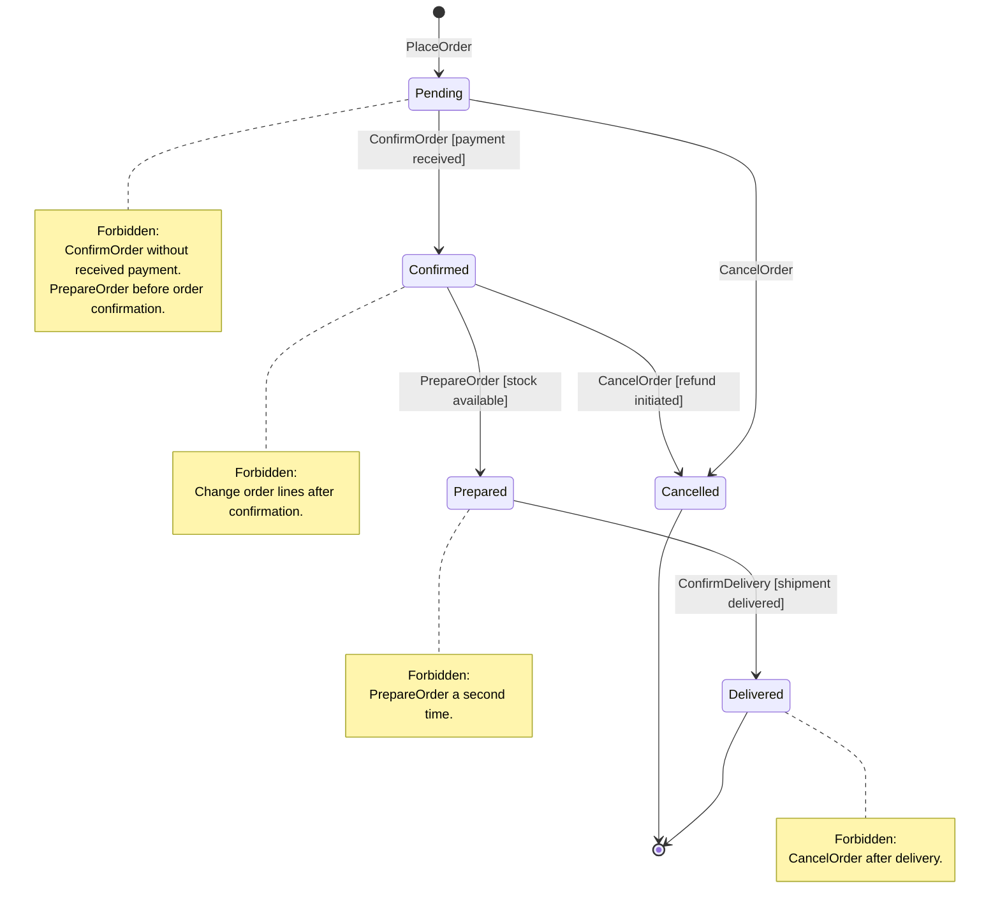

# BookShop — Order Lifecycle, Business Invariants and Design Pattern

## 1. Order Lifecycle State Machine



## 2. State Descriptions

| State | Description | Bounded Context |
|---|---|---|
| Pending | Order has been placed and awaits payment confirmation. | Orders |
| Confirmed | Payment has been received and the order is confirmed. | Orders |
| Cancelled | Order has been cancelled. | Orders |
| Prepared | Warehouse has prepared the order for dispatch. | Fulfilment |
| Delivered | Order has been delivered to the customer. | Fulfilment |

## 3. Business Invariants

| Aggregate | Business Invariant | Domain Exception |
|---|---|---|
| Order | An order can be confirmed only when its status is Pending and payment has been received. | OrderCannotBeConfirmedException |
| Order | An order that has already been cancelled cannot be cancelled again. | OrderCannotBeCancelledException |
| OrderLine | An order line must have a positive quantity. | InvalidOrderQuantityException |
| Payment | A payment amount must be greater than zero. | InvalidPaymentAmountException |
| Payment | A payment cannot be confirmed after its retry deadline has expired. | PaymentRetryWindowExpiredException |
| InventoryItem | Reserved stock cannot exceed the available physical stock. | InsufficientStockException |
| Shipment | A shipment can be prepared only for a confirmed order with available stock. | OrderNotReadyForShipmentException |
| Delivery | Delivery can be confirmed only after the shipment has been prepared and dispatched. | ShipmentNotReadyForDeliveryException |

## 4. Given–When–Then Scenarios

### Scenario 1 — Place an Order (Positive)

**Given:** A customer provides a valid CustomerId and at least one order item with a positive quantity and unit price.

**When:** The system executes PlaceOrder.

**Then:** The order is created with Pending status, its total amount is calculated and an OrderPlaced event is raised.

### Scenario 2 — Confirm a Payment (Positive)

**Given:** A payment is Pending and its retry deadline has not expired.

**When:** The system executes ConfirmPayment with a valid provider reference.

**Then:** The payment status changes to Received and a PaymentReceived event is raised.

### Scenario 3 — Confirm an Order Without Payment (Negative)

**Given:** An order is Pending and its payment has not been received.

**When:** The system executes ConfirmOrder with paymentReceived set to false.

**Then:** OrderCannotBeConfirmedException is thrown and the order remains Pending.

### Scenario 4 — Confirm Payment After the Retry Deadline (Negative)

**Given:** A payment has passed its retry deadline.

**When:** The system executes ConfirmPayment.

**Then:** PaymentRetryWindowExpiredException is thrown and the payment is not changed to Received.

## 5. GoF Design Pattern — Factory Method

The Order aggregate uses the Factory Method pattern for controlled object creation.

The Order class has a private constructor and a public static factory method named PlaceOrder.

The factory method:

- Validates the input data.
- Creates the Order object.
- Creates and adds OrderLine objects.
- Calculates the order total.
- Raises the OrderPlaced domain event.
- Returns the created Order.

Example:

```csharp
Order order = Order.PlaceOrder(
    customerId,
    items,
    createdAt
);
```

The Factory Method ensures that an order is created through one controlled business operation and that its business rules are checked during creation.

## 6. Event Storming Bounded Contexts

| Bounded Context | Main Business Concepts |
|---|---|
| Product | Book catalogue, book information, publishing |
| Inventory | Stock quantity, stock reservation, stock availability |
| Customer | Customer registration, customer account, book search |
| Orders | Place order, cancel order, confirm order |
| Payments | Initiate payment, reject payment, confirm payment |
| Fulfilment — Shipment | Prepare order, shipment details |
| Fulfilment — Delivery | Confirm delivery, delivery details |
